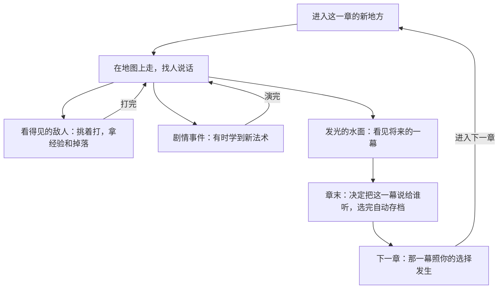
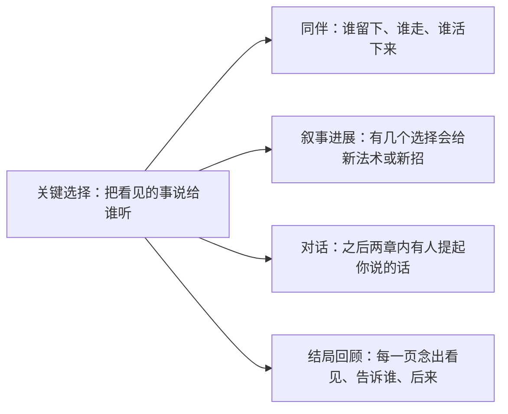
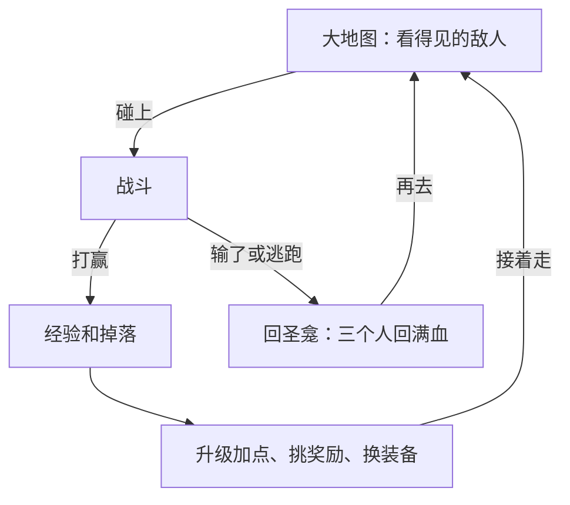
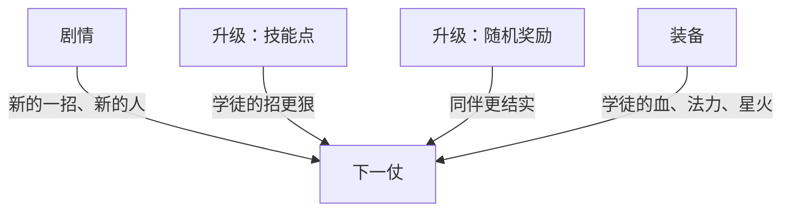

# GDD · 梅林的学徒（暂定名）

更新于 2026-11-06。这是整个设计的入口：上半页一页看懂这个游戏，下半页是所有设计文档的目录。任何一份文档改了，回来更新目录里那一行。

## 一页看懂

**一句话**：你能在水面上看见家里人的将来。每一章，你都要决定把看见的事说给谁听；大结局改不了，但谁陪亚瑟走到最后，由你说出口的话决定。两次看水面之间，你在地图上挑着打看得见的敌人，升级、换装备。

**RPG 类型**：CRPG 式对话抉择 + 明雷大地图（照《Vampire's Fall 2》：看得见的敌人、经验和技能树、随机掉落）+ 意图预告的回合制战斗（照《杀戮尖塔》） · **给谁玩、在什么设备上、一次玩多久**：喜欢剧情和选择的人，不考操作；网页上玩，电脑键盘为主，手机触屏也能玩；一场任务战 2–3 分钟、地图小仗 1–2 分钟，一章 20–35 分钟，全程约 3 小时 20 分钟到 3 小时 50 分钟（比 GAME_BRIEF 估的多，第 11 步范围复盘定砍不砍）。

### 一章怎么玩
<!-- figure: chapter-loop -->

### 你说出口的话改变什么
<!-- figure: choice-effects -->

### 一场仗从哪来、打完去哪
<!-- figure: battle-loop -->

### 变强从哪来
<!-- figure: growth-sources -->

| 系统 | 一句大白话 | 设计页 |
|---|---|---|
| 看水面与预言簿 | 在水面上看见将来的一幕，选把它说给谁听，选完不能改 | design/systems/prophecy.md |
| 对话 | 走到人跟前说话；不掷骰；人们记得你告诉过他们什么 | design/systems/dialogue.md |
| 同伴 | 谁在你身边、谁能上场，由剧情和你说的话决定；第 3 章起画成圆桌 | design/systems/companions.md |
| 战斗 | 敌人这回合要对谁出什么招先亮出来，你给三个人各选一招，选满自动开打；血带出战斗 | design/systems/combat.md |
| 叙事进展 | 关键的新法术、新同伴、梅林的杖由剧情给，有的看你的选择 | design/systems/story-unlocks.md |
| 经验和技能点 | 打赢拿经验，升一级 2 个技能点加进四棵树，再挑一张随机奖励 | design/systems/progression.md |
| 装备和掉落 | 打怪、开宝物掉银币、药和装备；三档品质带词缀；学徒换上样子会变 | design/systems/items.md |
| 任务 | 每章一条主线标着下一步；支线靠别人的话找，章末关 | design/systems/quests.md |
| 大地图 | 一章一片地方；敌人看得见、会追，打死就没了；圣龛回血；四个地方看得出你的选择 | design/systems/overworld.md |

## 目录
全部文件都在 GitHub 仓库 [salt-byte/arthur-rpg](https://github.com/salt-byte/arthur-rpg)，每一步交接前推送。

项目主页（claude.ai/artifact/7GrrutxtorkDnBVH2DNaTN）把需求、故事、概念、原型、剧情谱、系统设计、画风放在一个页面里分页看，由插件 producer 的 render_site.py 从下面这些文件生成；系统设计那一页的手画图在 design/figures/。

| 文档 | 写什么 | 负责 skill | 更新于 | 状态 | 在哪看 |
|---|---|---|---|---|---|
| GAME_BRIEF.md | 需求和已经定了的事 | producer | 2026-11-06 | 已确认（A0、A1、A2）；玩法参考 2026-11-06 改 | 项目主页「需求」；[GitHub](https://github.com/salt-byte/arthur-rpg/blob/main/GAME_BRIEF.md) |
| design/CONCEPT.md | 这是个什么样的游戏 | game-concept | 2026-11-06 | 已确认（A1，2026-11-06 重过） | 项目主页「概念」；[GitHub](https://github.com/salt-byte/arthur-rpg/blob/main/design/CONCEPT.md) |
| prototypes/ | 玩法原型：怎么打、两次看水面之间 | gameplay-prototype | 2026-11-06 | 怎么打：继续，行动版；两次看水面之间：移到第 10 步白盒 | 项目主页「原型」；[GitHub](https://github.com/salt-byte/arthur-rpg/tree/main/prototypes) |
| content/story/bible.md | 故事圣经：世界、人物、选择和后果 | story-bible | 2026-11-05 | 已确认（A2） | 项目主页「故事」；[GitHub](https://github.com/salt-byte/arthur-rpg/blob/main/content/story/bible.md) |
| content/story/story.html | 剧情谱 | story-map | 2026-11-05 | 已确认（A2） | 项目主页「剧情谱」；[GitHub](https://github.com/salt-byte/arthur-rpg/blob/main/content/story/story.html) |
| content/story/review_A2.md | 剧情审查报告和复查 | story-review | 2026-11-05 | 已确认（A2） | [GitHub](https://github.com/salt-byte/arthur-rpg/blob/main/content/story/review_A2.md) |
| design/systems/*.md | 九个系统的规则 | game-design | 2026-11-06 | 第 7 步重做：战斗、大地图重写，成长、装备新写，叙事进展改了一段；待你确认 | 项目主页「系统设计」；[GitHub](https://github.com/salt-byte/arthur-rpg/tree/main/design/systems) |
| design/ui/SCREENS.md | 有哪些屏幕、怎么跳 | game-design → ui-layout | 2026-11-06 | 加了圣龛、背包、技能树、升级、商店几屏；待你确认 | 项目主页「系统设计」；[GitHub](https://github.com/salt-byte/arthur-rpg/blob/main/design/ui/SCREENS.md) |
| design/CONTENT_SCHEDULE.md | 每章第一次出现什么、难到什么程度 | game-design → story-bible → quest-design | 2026-11-06 | 故事列已确认；玩法列待你确认；遭遇列第 10 步填 | 项目主页「系统设计」；[GitHub](https://github.com/salt-byte/arthur-rpg/blob/main/design/CONTENT_SCHEDULE.md) |
| content/data/*.json | 设计页里每个会调的数 | game-design → balancing | 2026-11-06 | 草稿；第 1 章的战斗数来自原型 | [GitHub](https://github.com/salt-byte/arthur-rpg/tree/main/content/data) |
| site/ | 项目主页的页面文件 | producer | 2026-11-06 | 每步重新生成 | 项目主页；[GitHub](https://github.com/salt-byte/arthur-rpg/tree/main/site) |
| content/README.md | 内容数据格式：变量、指令、任务表、遭遇表 | game-data-schema | 2026-11-05 | 草稿（第 6 步） | [GitHub](https://github.com/salt-byte/arthur-rpg/blob/main/content/README.md) |
| project.godot、scripts/ | Godot 4.3 工程骨架：读数据、跑对白、存读档 | godot-project-structure | 2026-11-05 | 旧白盒的代码，读的是旧格式的 combat.json；第 10 步白盒重做时改 | [GitHub](https://github.com/salt-byte/arthur-rpg/tree/main/scripts) |
| design/ART_DIRECTION.md | 画风：视觉原则、怎么一眼认出、颜色随章节褪色、界面风格、两张目标图 | art-direction → ui-layout | 2026-11-06 | 已确认（B） | 项目主页「画风」；[GitHub](https://github.com/salt-byte/arthur-rpg/blob/main/design/ART_DIRECTION.md) |
| design/targets/ | 目标图：庆功宴的酒杯、教堂里凯改口 | art-direction | 2026-11-06 | 已确认（B） | [GitHub](https://github.com/salt-byte/arthur-rpg/tree/main/design/targets) |
| CREDITS.md | 用到的美术和字体署名 | asset-sourcing | 2026-11-06 | 每加一个素材加一行 | [GitHub](https://github.com/salt-byte/arthur-rpg/blob/main/CREDITS.md) |
| design/_draft_v1/ | 换流程之前的旧草稿 | — | 2026-11-05 | 只作参考，不再更新 | [GitHub](https://github.com/salt-byte/arthur-rpg/tree/main/design/_draft_v1) |
