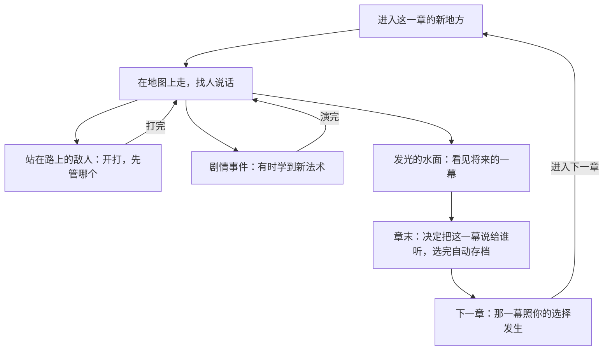
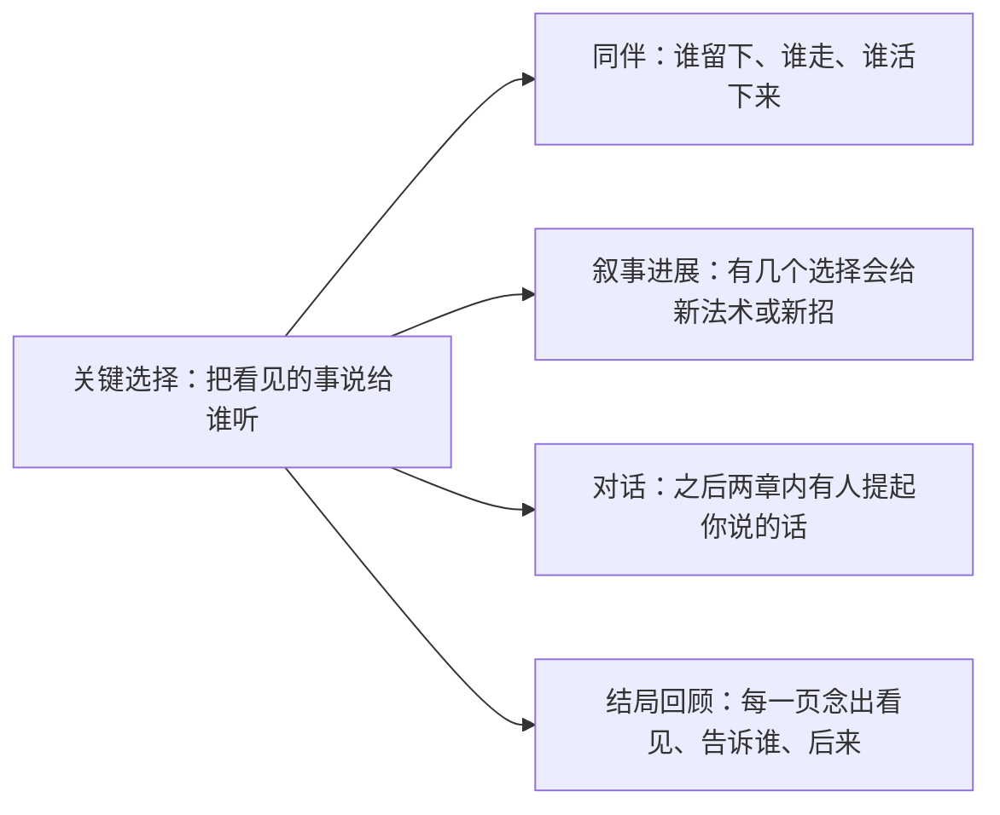
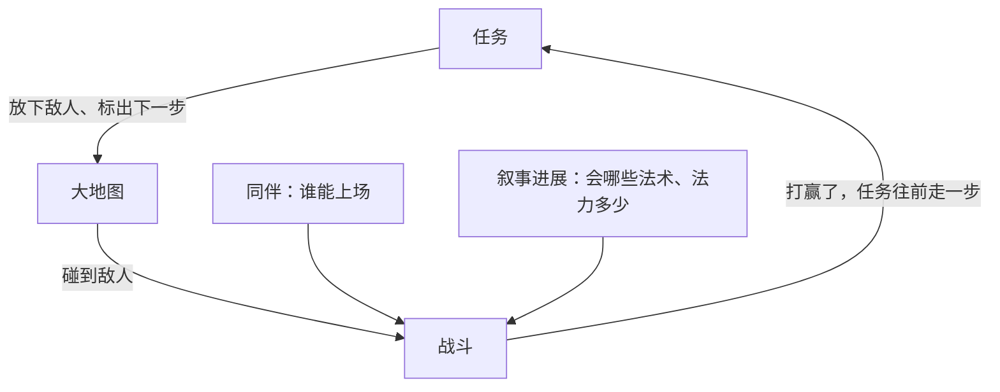

# GDD · 梅林的学徒（暂定名）

更新于 2026-11-05。这是整个设计的入口：上半页一页看懂这个游戏，下半页是所有设计文档的目录。任何一份文档改了，回来更新目录里那一行。

## 一页看懂

**一句话**：你能在水面上看见家里人的将来。每一章，你都要决定把看见的事说给谁听；大结局改不了，但谁陪亚瑟走到最后，由你说出口的话决定。

**RPG 类型**：CRPG 式对话抉择 + 大地图加回合制遭遇 + 回合制（JRPG）战斗 · **给谁玩、在什么设备上、一次玩多久**：喜欢剧情和选择的人，不考操作；网页上玩，电脑键盘为主，手机触屏也能玩；一场仗 2–3 分钟，一章 15–30 分钟，全程约 2 小时 50 分钟。

### 一章怎么玩
<!-- figure: chapter-loop -->

### 你说出口的话改变什么
<!-- figure: choice-effects -->

### 一场仗从哪来、打完去哪
<!-- figure: battle-loop -->

| 系统 | 一句大白话 | 设计页 |
|---|---|---|
| 看水面与预言簿 | 在水面上看见将来的一幕，选把它说给谁听，选完不能改 | design/systems/prophecy.md |
| 对话 | 走到人跟前说话；不掷骰；人们记得你告诉过他们什么 | design/systems/dialogue.md |
| 同伴 | 谁在你身边、谁能上场，由剧情和你说的话决定；第 3 章起画成圆桌 | design/systems/companions.md |
| 战斗 | 敌人这回合要做什么先亮出来，你给每个人选一个行动，决定先管哪个 | design/systems/combat.md |
| 叙事进展 | 不升级；新法术、法力上限、新同伴都由剧情给，有的看你的选择 | design/systems/story-unlocks.md |
| 任务 | 每章一条主线标着下一步；支线靠别人的话找，章末关 | design/systems/quests.md |
| 大地图 | 一章一片地方；敌人站在路上看得见；四个地方看得出你的选择 | design/systems/overworld.md |

## 目录
全部文件都在 GitHub 仓库 [salt-byte/arthur-rpg](https://github.com/salt-byte/arthur-rpg)，每一步交接前推送。

「设计总览」页面（claude.ai/artifact/PDbi5mUqefHPVFycQwW7Nc）把这份总览、七个设计页、界面清单和章节内容表放在一页里看，由插件 game-design 的 render_design.py 从下面这些 .md 生成，手画的图在 design/figures/。

| 文档 | 写什么 | 负责 skill | 更新于 | 状态 | 在哪看 |
|---|---|---|---|---|---|
| GAME_BRIEF.md | 需求和已经定了的事 | producer | 2026-11-05 | 已确认（A0、A1、A2） | [GitHub](https://github.com/salt-byte/arthur-rpg/blob/main/GAME_BRIEF.md)；项目「RPG游戏」 |
| design/CONCEPT.md | 这是个什么样的游戏 | game-concept | 2026-11-05 | 已确认（A1）；第 5 步改了两处，见它的改动记录 | [GitHub](https://github.com/salt-byte/arthur-rpg/blob/main/design/CONCEPT.md)；项目 |
| content/story/bible.md | 故事圣经：世界、人物、选择和后果 | story-bible | 2026-11-05 | 已确认（A2） | [GitHub](https://github.com/salt-byte/arthur-rpg/blob/main/content/story/bible.md)；项目 |
| content/story/story.html | 剧情谱 | story-map | 2026-11-05 | 已确认（A2） | 「剧情谱」页面（claude.ai/artifact/YBTU7Z3DxcNxYVBdA8YWhW）；[GitHub](https://github.com/salt-byte/arthur-rpg/blob/main/content/story/story.html) |
| content/story/review_A2.md | 剧情审查报告和复查 | story-review | 2026-11-05 | 已确认（A2） | [GitHub](https://github.com/salt-byte/arthur-rpg/blob/main/content/story/review_A2.md)；项目 |
| design/systems/*.md | 七个系统的规则 | game-design | 2026-11-05 | 待你确认 | 「设计总览」页面；[GitHub](https://github.com/salt-byte/arthur-rpg/tree/main/design/systems)；项目 |
| design/ui/SCREENS.md | 有哪些屏幕、怎么跳 | game-design → ui-layout | 2026-11-05 | 待你确认 | 「设计总览」页面；[GitHub](https://github.com/salt-byte/arthur-rpg/blob/main/design/ui/SCREENS.md)；项目 |
| design/CONTENT_SCHEDULE.md | 每章第一次出现什么、难到什么程度 | game-design → story-bible → quest-design | 2026-11-05 | 故事列已确认；玩法列待你确认；遭遇列第 10 步填 | 「设计总览」页面；[GitHub](https://github.com/salt-byte/arthur-rpg/blob/main/design/CONTENT_SCHEDULE.md)；项目 |
| content/data/*.json | 设计页里每个会调的数 | game-design → balancing | 2026-11-05 | 草稿 | [GitHub](https://github.com/salt-byte/arthur-rpg/tree/main/content/data)；项目 |
| design/design_overview.html | 「设计总览」页面：上面几份设计文档合成的一页 | game-design | 2026-11-05 | 跟着各 .md 重新生成 | 「设计总览」页面；[GitHub](https://github.com/salt-byte/arthur-rpg/blob/main/design/design_overview.html) |
| design/ART_DIRECTION.md | 画风 | art-direction | — | 未开始（第 7 步） | — |
| design/_draft_v1/ | 换流程之前的旧草稿 | — | 2026-11-05 | 只作参考，不再更新 | [GitHub](https://github.com/salt-byte/arthur-rpg/tree/main/design/_draft_v1)；项目 |
