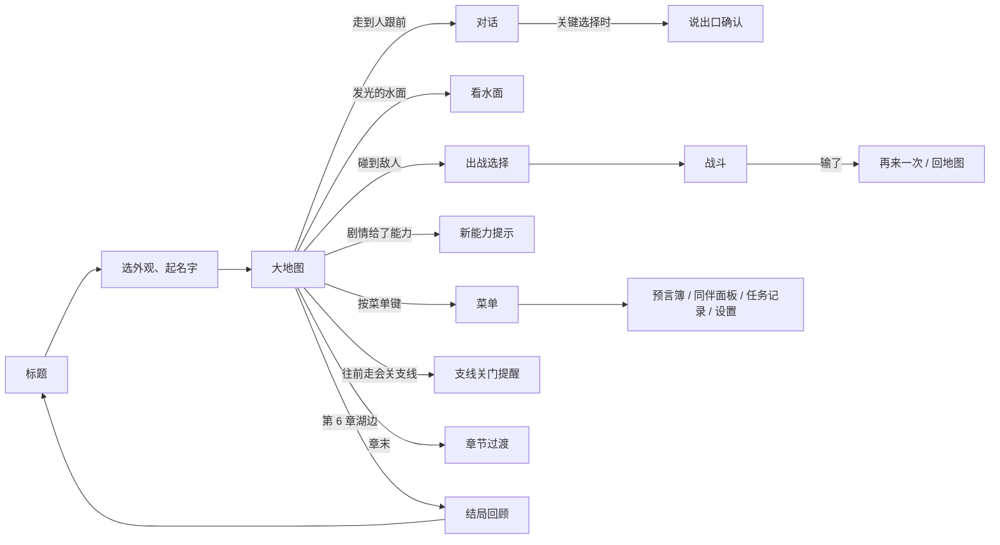

# 界面清单 · 梅林的学徒（暂定名）

第 5 步写出有哪些屏幕、从哪进、怎么跳；布局和样式之后由 ui-layout 按画风文档补（第 7 步之后）。一屏 = 玩家能看到的一个完整画面，或盖在上面的一个面板、一个弹窗。

## 怎么跳

<!-- figure: screen-flow -->

每一条从大地图出发的路，走完都回到大地图；只有结局回顾回到标题。

## 每一屏
| 屏幕 | 从哪进 / 回到哪 | 上面有什么 | 玩家在这里做什么 | 用到的系统 | 层 |
|---|---|---|---|---|---|
| 大地图 | 开场、对话 / 战斗 / 菜单结束后 | 地图和人物；屏幕上方「下一步：……」；主线标记；人物头上的「…」；发光的水面；手机上的方向键、确认键、菜单键 | 去哪、先找谁说话、要不要现在碰那群敌人 | 大地图、任务 | mvp |
| 对话 | 走到人跟前按确认，或剧情自动开始 / 回到大地图 | 头像、名字、一句话（不超过 40 字）；选项列表，关键选择带水滴标记 | 选怎么回答；关键选择时决定说给谁听 | 对话、看水面与预言簿 | mvp |
| 说出口确认 | 选中关键选择 / 回到对话（取消回到选项） | 「说出口就不能收回。确定吗？」、确定、取消 | 确定还是再想想 | 看水面与预言簿 | mvp |
| 看水面 | 在发光的水面按确认，或剧情里看酒杯、圣水盆、木碗 / 回到对话或大地图 | 一张静止的画面，下面两三句描写；「记进预言簿」 | 看清这一幕是谁、在哪 | 看水面与预言簿 | mvp |
| 战斗 | 在地图上碰到敌人，或剧情战 / 赢了回大地图 | 敌人和他们头上的意图（目标箭头、点数、出手顺序、「？」）；我方每人的血量；学徒的法力；当前选人的行动菜单（法力不够的灰掉）；「结束回合」；学过静水时，多看一回合的预览 | 每回合先管哪个威胁：打谁、护谁、打断谁、要不要花法力多看一回合或揭开「？」 | 战斗、同伴、叙事进展 | mvp |
| 再来一次 / 回地图 | 战斗输了 / 回到这场开头，或回到碰到敌人之前 | 一句「你们倒下了」；两个按钮 | 原样再打，还是回去换上场的人 | 战斗 | mvp |
| 新能力提示 | 剧情演完得到或失去能力 / 回到大地图 | 名字、一句效果、一句来历（「梅林在院子里教你的」）；得到和失去两种样子 | 读完就关 | 叙事进展 | mvp |
| 菜单 | 大地图按菜单键 / 回到大地图 | 预言簿、同伴、任务记录、设置 | 打开哪一个 | 界面 | mvp |
| 预言簿 | 菜单；看水面以后 / 回到菜单 | 每页一幕：画面缩略图、看见了什么、告诉了谁（或「还没决定」）、后来怎样 | 翻回去看自己看见过什么、还有哪件事没决定 | 看水面与预言簿 | mvp |
| 同伴面板 | 菜单 / 回到菜单 | 第 1–2 章一张名单，第 3 章起一张圆桌；每人的状态（坐着、空椅子、盖布）；点开是他的卡片：现在怎么看你、你告诉过他什么、他在战斗里的招 | 看谁还在、关系怎么变了 | 同伴 | mvp（第 1–2 章名单）/ playable（圆桌） |
| 章节过渡 | 一章最后一步结束 / 进入下一章的大地图 | 章名；这章没做的支线；下一章的地名 | 读完继续 | 任务、大地图 | mvp |
| 选外观、起名字 | 新游戏 / 进入大地图 | 几种外观，一个名字输入框（有默认名） | 选你长什么样、叫什么 | 对话 | playable |
| 标题 | 打开网页 / 进入选外观，或继续存档 | 游戏名；新游戏；继续（有存档时） | 开始新的还是继续 | 存档 | playable |
| 出战选择 | 碰到敌人且能上场的人超过 2 个 / 进入战斗 | 能上场的同伴（头像、血量、招）；剧情规定的人带锁；选够 2 个才能开打 | 带哪两个人去 | 同伴、战斗 | playable（第 3 章起才用到） |
| 任务记录 | 菜单 / 回到菜单 | 主线：当前一步。支线：谁告诉你的、他的原话、做到哪、开着还是关了 | 想起支线该去哪找 | 任务 | playable |
| 支线关门提醒 | 走向会关掉支线的那一步 / 回到大地图 | 「往前走，『……』就做不了了。现在往前走吗？」；往前走、先不走 | 先回去做支线，还是往前走 | 任务 | playable |
| 结局回顾 | 第 6 章湖边做完最后的选择 / 回到标题 | 逐页念出：你看见了什么、告诉了谁、那个人后来怎样；最后是你自己的结局 | 读完 | 看水面与预言簿、同伴 | playable |
| 设置 | 菜单 / 回到菜单 | 打字速度 | 调快调慢 | 对话 | playable |
| 对话回看 | 对话中 / 回到对话 | 这段对话前面说过的话 | 回看漏掉的一句 | 对话 | full |

第 6 章「船走远以后，你去哪」是一次关键选择，用的就是对话和说出口确认这两屏，不另做屏幕。

## 规则
- 设计页里提到的每个面板、按钮栏、提示框、弹窗，都要在这张表里有一行；表里没有的，ui-layout 不做。
- 「上面有什么」只写信息和控件，不写颜色、字号和尺寸，那是 ui-layout 的事。
- 白盒切片只做 mvp 层的屏幕。
